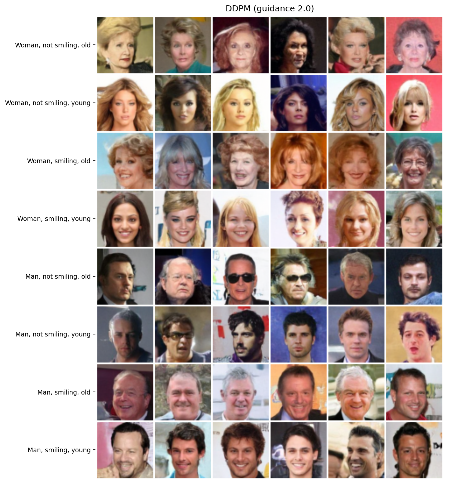
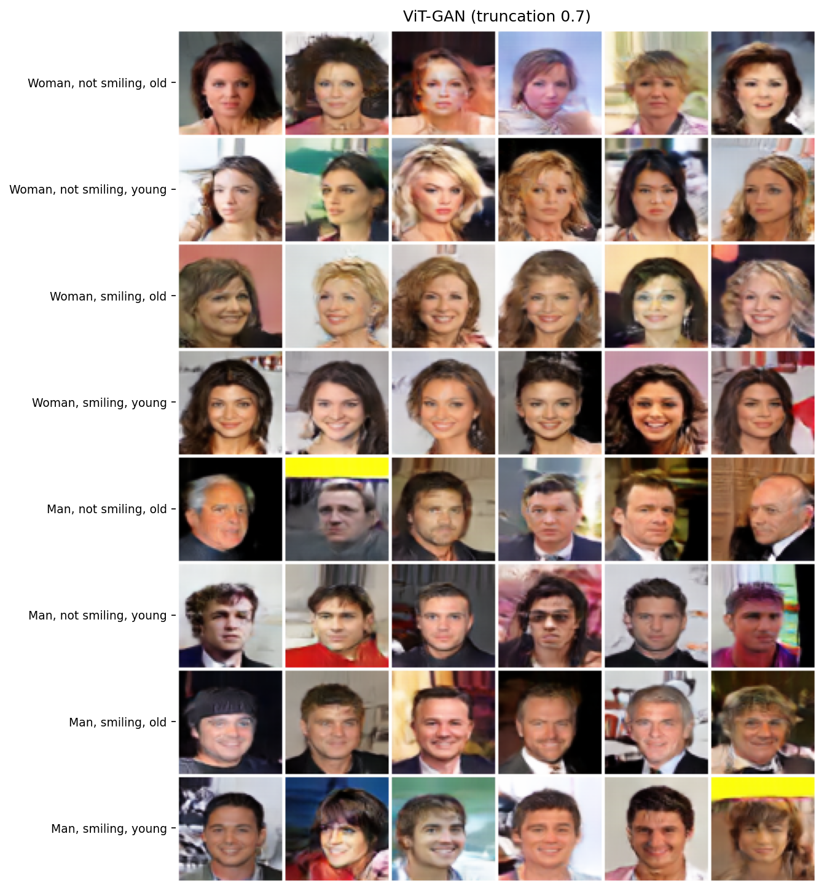
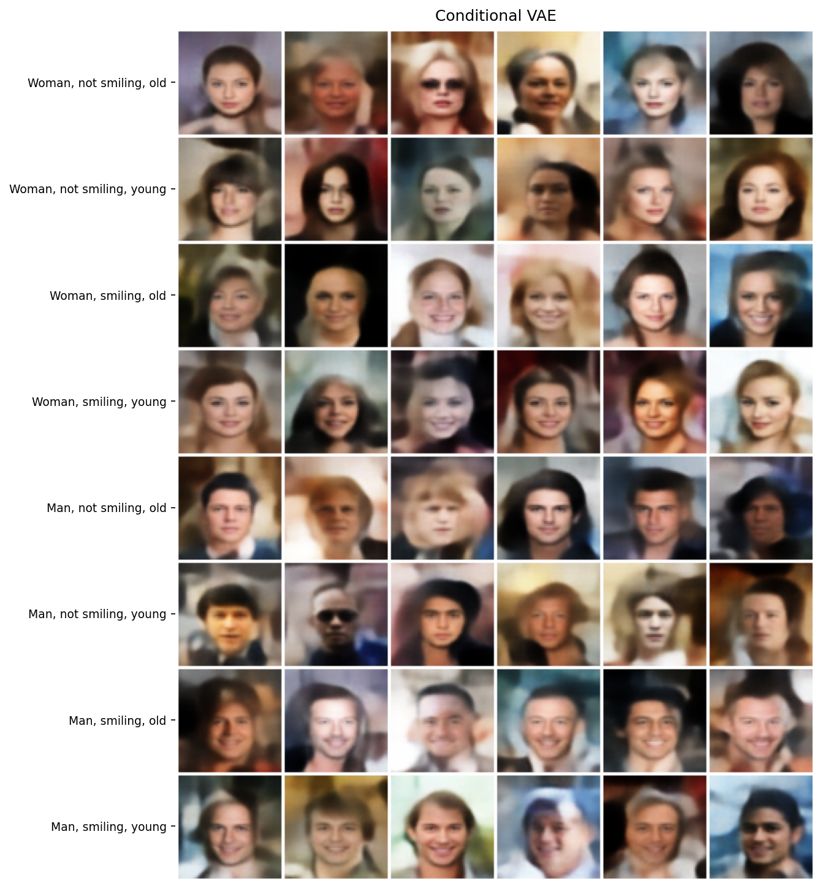
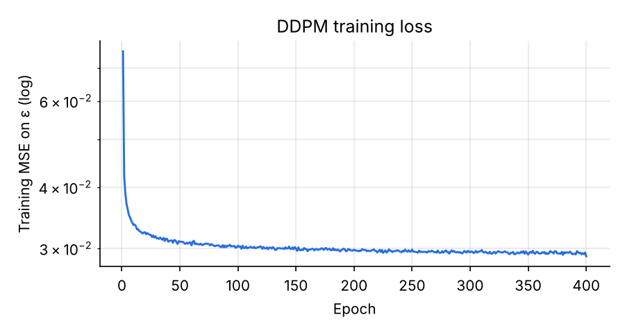
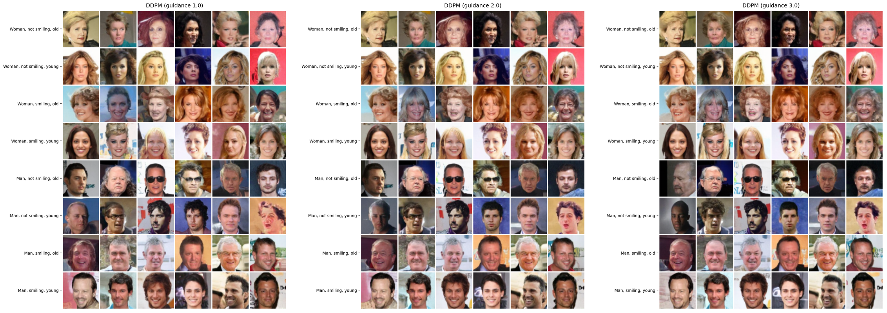
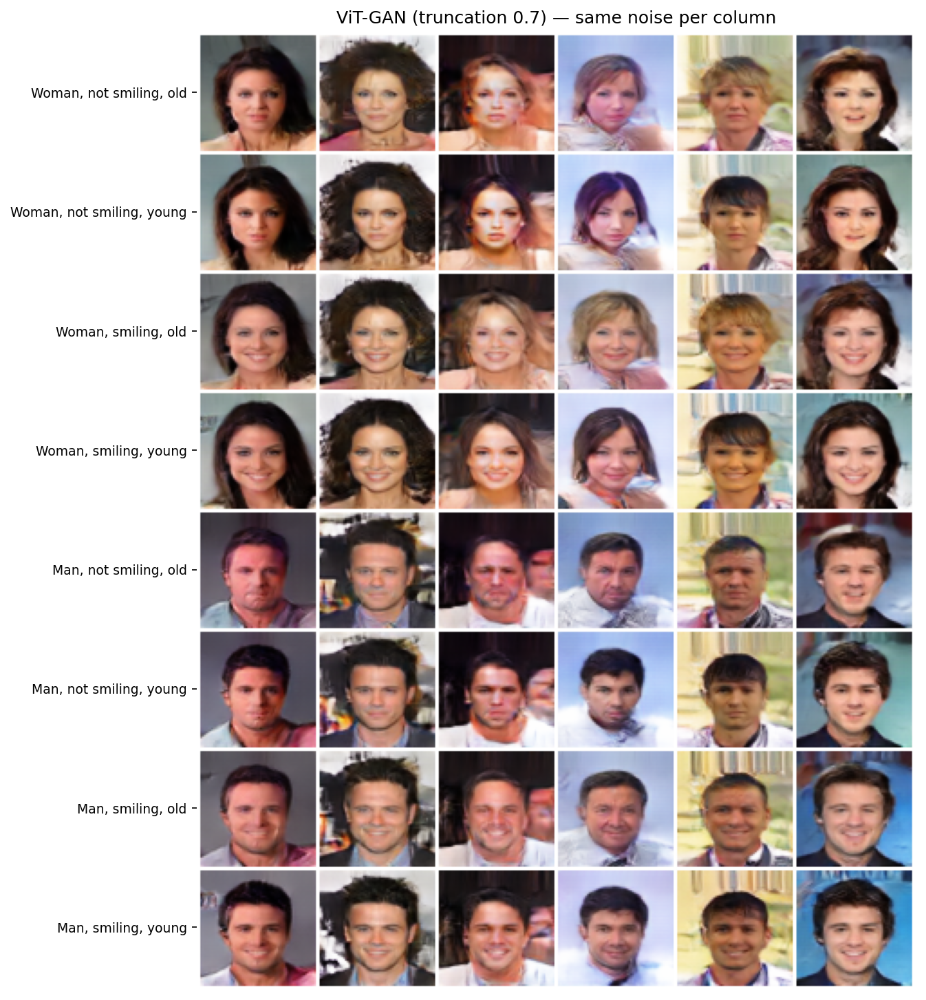
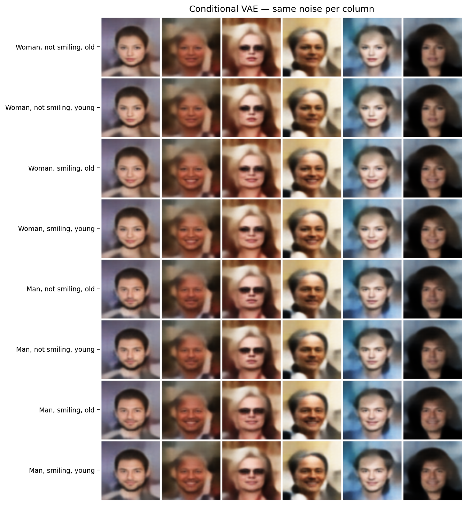

# Conditional Face Generation

Three conditional generative models trained on **CelebA** to generate 64×64 faces with controllable attributes: **Male**, **Smiling** and **Young** (8 combinations).

| Model | Generator params | Conditioning | Training objective |
|---|---|---|---|
| **Conditional VAE** | 4.5 M | attributes as extra input channels (encoder) and concatenated to *z* (decoder) | MSE reconstruction + KL |
| **ViT-GAN** | 19.7 M (+2.8 M discriminator) | attributes concatenated to the noise before the token projection | BCE with label smoothing + diversity loss |
| **Conditional DDPM** | 26.4 M | attributes projected and added at every U-Net level, classifier-free guidance | ε-prediction MSE |

<p align="center">
  
  
  
</p>
<p align="center"><em>Left to right: DDPM (guidance 2.0), ViT-GAN (truncation 0.7), Conditional VAE. One row per attribute combination.</em></p>

University project for the *Generative AI* course (MSc in Computer Engineering, University of Salerno), developed in a team of four. I designed and trained the **diffusion model**; the CVAE and the ViT-GAN were developed by my teammates (see [Authors](#authors)).

---

## Models

### Conditional DDPM (`diffusion/`)

A denoising diffusion probabilistic model with a conditional U-Net that predicts the noise ε(x<sub>t</sub>, t, c).

- **Noise schedule:** cosine schedule (Nichol & Dhariwal, 2021) with 1000 steps.
- **U-Net:** 64 → 32 → 16 → 8 with channels 64 / 128 / 256 / 512, built recursively. Each level has residual blocks (GroupNorm → SiLU → Conv, with the time embedding added in between) and **multi-head self-attention at 16×16 and 8×8**; the bottleneck is ResBlock → Attention → ResBlock.
- **Time:** sinusoidal encoding followed by an MLP, injected in every residual block.
- **Attributes:** encoded as −1 / +1 and added to the feature maps through a linear projection on both the down and the up path of every level.
- **Classifier-free guidance:** the condition is replaced by the zero vector with probability 0.2 during training, so the same network also learns the unconditional model. At sampling time ε = ε<sub>uncond</sub> + w · (ε<sub>cond</sub> − ε<sub>uncond</sub>).
- **Static thresholding:** at every sampling step the predicted x<sub>0</sub> is clamped to [−1, 1] and ε is recomputed from it, which keeps the trajectory in the data range.
- **Training:** 400 epochs, Adam (lr 1e-4), batch 64, gradient clipping at 1.0.

<p align="center"></p>

### ViT-GAN (`vit_gan/`)

- **Generator:** noise (128-d) and attributes are concatenated and projected into an 8×8 grid of 512-d tokens with sinusoidal positional encoding, refined by 6 pre-norm Transformer blocks (8 heads) and upsampled to 64×64 by a transposed-convolution head.
- **Discriminator:** convolutional, with spectral normalization on every layer; the attributes are mapped to a 64×64 map and stacked on the image as a fourth channel.
- **Loss:** BCE with noisy label smoothing (real targets in [0.9, 1], fake in [0, 0.1]) plus a **per-instance diversity loss**: two images generated from the same attributes and different noise are penalised when their mean L1 distance is below a margin of 0.5 (weight 2.0), to counter mode collapse.
- **Training:** 400 epochs, Adam with β₁ = 0.5, lr 1e-4 (G) / 4e-4 (D), batch 128.

### Conditional VAE (`cvae/`)

- **Encoder:** 4 strided convolutions (6 → 256 channels, 64 → 4) on the image plus 3 constant attribute channels, followed by two linear heads for μ and log σ².
- **Decoder:** *z* (256-d) concatenated to the attributes, a linear layer and 4 transposed convolutions back to 64×64 with Tanh output.
- **Loss:** summed MSE reconstruction + KL divergence (β = 1).
- **Training:** Adam (lr 1e-3, weight decay 1e-5), batch 256, 80/20 train/validation split with early stopping on the validation loss.

## Results

All figures were generated with [`generate.py`](generate.py) from the released weights (seed 42, on a T4 GPU).

### Classifier-free guidance (DDPM)

<p align="center"></p>
<p align="center"><em>Same initial noise, guidance 1.0 / 2.0 / 3.0.</em></p>

Raising the guidance scale from 1.0 to **2.0** makes the attributes more pronounced (clearer smiles and age cues) and the faces sharper. At 3.0 the samples start to over-saturate, with darker colors and exaggerated contrast, the typical sign of excessive guidance. **2.0** is the default in `generate.py` and the value used for the previews during training.

### Attribute control with fixed noise

Reusing the **same noise in each column**, only the attributes change along the column, which shows how well the conditioning is disentangled from the identity:

<p align="center">
  
  
</p>

### Comparison

- The **DDPM** gives the most realistic and diverse samples and follows the attributes reliably, at the cost of 1000 denoising steps with two network evaluations each (conditional and unconditional).
- The **ViT-GAN** produces sharp faces in a single forward pass and preserves the identity well when only the attributes change. Scaling the noise by 0.7 (*truncation trick*) removes most of the artifacts; below ~0.6 the faces become too similar to each other. Some artifacts remain on a few backgrounds.
- The **CVAE** is the smallest and most stable model to train, but its samples are blurry: with a pixel-wise MSE reconstruction loss and a Gaussian posterior, the decoder learns to output the average of the plausible images. Lowering the sampling temperature does not make them sharper, only more uniform.

> **Note on preprocessing:** the DDPM uses a center crop of 178×178 before resizing to 64×64, while the CVAE and the ViT-GAN resize the full 178×218 image directly, which slightly stretches the faces vertically. The released weights were trained this way and the scripts are kept consistent with them.

## Usage

### Setup

```bash
git clone https://github.com/RaffaeleRosanova01/conditional-face-generation.git
cd conditional-face-generation
pip install -r requirements.txt
```

### Pretrained weights

Download the weights from the [Releases](https://github.com/RaffaeleRosanova01/conditional-face-generation/releases) page into `weights/`:

| File | Model | Size |
|---|---|---|
| `diffusion.pth` | DDPM U-Net (epoch 400) | 105 MB |
| `vit_gan_G.pth` | ViT-GAN generator (epoch 400) | 79 MB |
| `cvae.pth` | Conditional VAE (best validation loss) | 18 MB |

### Generation

```bash
python generate.py --model diffusion --weights weights/diffusion.pth --guidance 2.0
python generate.py --model vit_gan   --weights weights/vit_gan_G.pth --truncation 0.7
python generate.py --model vit_gan   --weights weights/vit_gan_G.pth --truncation 0.7 --fixed-noise
python generate.py --model cvae      --weights weights/cvae.pth
```

Each command saves a grid with one row per attribute combination (`--samples` columns, default 6) to `samples/<model>.png`. Options: `--seed`, `--output`, `--fixed-noise` and `--truncation` (CVAE, ViT-GAN), `--guidance` (DDPM, default 2.0). The weights can also be the full training checkpoints. The DDPM runs 1000 denoising steps and is slow on CPU; a GPU is recommended.

### Training

The scripts use the [CelebA](https://mmlab.ie.cuhk.edu.hk/projects/CelebA.html) dataset (aligned images and attribute annotations).

```bash
# DDPM and ViT-GAN: torchvision layout, i.e. <data-root>/celeba/{img_align_celeba/, list_attr_celeba.txt, list_eval_partition.txt, ...}
python -m diffusion.train --data-root /path/to/data
python -m vit_gan.train   --data-root /path/to/data

# CVAE: folder that directly contains list_attr_celeba.(txt|csv) and img_align_celeba/ (also works with the Kaggle version)
python -m cvae.train --data-root /path/to/data/celeba
```

All hyperparameters are exposed as command-line arguments (`--help`). The DDPM and ViT-GAN scripts resume automatically from their latest checkpoint in `outputs/<model>/checkpoints`.

The models were trained on a SLURM GPU cluster; [`slurm/train.slurm`](slurm/train.slurm) is a generic job script:

```bash
sbatch slurm/train.slurm diffusion --data-root /path/to/data
```

## Project structure

```
├── generate.py            # unified generation CLI for the three models
├── diffusion/
│   ├── model.py           # noise schedule, conditional U-Net, DDPM sampler with CFG
│   └── train.py
├── vit_gan/
│   ├── generator.py       # ViT generator
│   ├── discriminator.py   # spectral-norm conditional discriminator
│   └── train.py
├── cvae/
│   ├── model.py
│   ├── dataset.py         # CelebA reader (official and Kaggle layouts)
│   └── train.py
├── slurm/train.slurm
└── assets/                # figures used in this README
```

## Authors

- **Raffaele Rosanova** ([@RaffaeleRosanova01](https://github.com/RaffaeleRosanova01)) — conditional DDPM, repository maintainer
- **Davide Iannone**
- **Antonio Martino**
- **Matteo La Manna** ([@matteolmn3](https://github.com/matteolmn3))

## License

[MIT](LICENSE)
